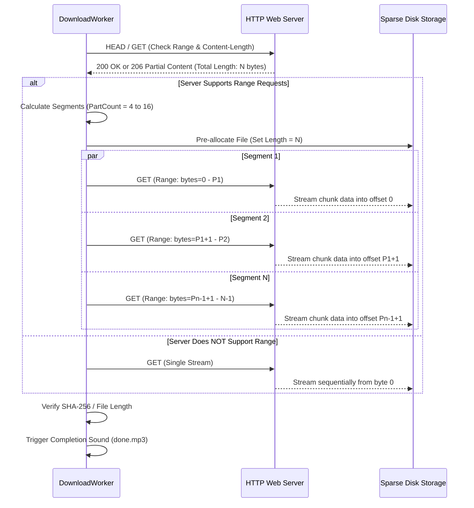

# Benzo (بينزو) — Master Architectural Blueprint & Technical Specification Report

> **Target Identity:**  
> - **Arabic Name:** بينزو  
> - **English Name:** Benzo  
> - **Package Name:** `khaled.benzo`  
> - **Target SDK:** 36 (Android 16 Ready) | **Min SDK:** 26 (Android 8.0 Oreo)  
> - **Reference Target Analyzed:** Advanced Download Manager (ADM v14.0.43 / `com.dv.adm`)  
> - **Methodology:** Autonomous Static & Reverse Engineering via REA v6.7.0, JADX Decompilation, AXML Parsing, and 129 UI Reference Image Correlation (`1.jpg`–`129.jpg`).

---

## Table of Contents
1. [Executive Summary & Product Architecture DNA](#1-executive-summary--product-architecture-dna)
2. [Complete Manifest & Android System Specifications](#2-complete-manifest--android-system-specifications)
3. [System Architecture & Clean-Room Layering](#3-system-architecture--clean-room-layering)
4. [High-Performance Multi-Threaded Download Engine](#4-high-performance-multi-threaded-download-engine)
5. [Foreground Service Lifecycle, WakeLock & Battery Management](#5-foreground-service-lifecycle-wakelock--battery-management)
6. [Native BitTorrent & Magnet Protocol Engine](#6-native-bittorrent--magnet-protocol-engine)
7. [Smart Built-in Browser & Media Sniffing Engine](#7-smart-built-in-browser--media-sniffing-engine)
8. [Comprehensive UI/UX Design System & 129 Screenshot Correlation Map](#8-comprehensive-uiux-design-system--129-screenshot-correlation-map)
9. [Data Persistence & Database Architecture (Room Schema)](#9-data-persistence--database-architecture-room-schema)
10. [Notification Engine & Channels Specification](#10-notification-engine--channels-specification)
11. [Target Adaptation & Refactoring Guide for `khaled.benzo`](#11-target-adaptation--refactoring-guide-for-khaledbenzo)
12. [Verification, Build & Release Protocols](#12-verification-build--release-protocols)

---

## 1. Executive Summary & Product Architecture DNA

**Benzo (بينزو)** is an industrial-grade, multi-threaded acceleration download manager and torrent client designed natively for Android. Engineered to operate under extreme network variations and strict modern Android background execution constraints, Benzo replicates the operational robustness of the world-leading mobile download managers (such as ADM) while adopting a modern, reactive Kotlin-first architecture.

### Key Performance & Architectural Benchmarks
- **Concurrent Task Engine:** Up to 5 simultaneous file downloads with independent worker pipelines.
- **Dynamic Multi-Part Chunking:** Up to 16 concurrent HTTP/HTTPS segments per file utilizing HTTP `Range` requests and pre-allocated sparse disk writes.
- **Resumption Fidelity:** Zero byte loss on network dropped connections, IP rotation, or unexpected application termination.
- **Native BitTorrent Integration:** Embedded `jlibtorrent` (C++ libtorrent wrapper) supporting magnet links, multi-file torrent filtering, DHT, PEX, and encryption.
- **Intelligent Media Sniffing:** Built-in multi-tab web browser capable of inspecting DOM, XHR, and Fetch pipelines to intercept streaming media (HLS `.m3u8`, MPEG-DASH `.mpd`, MP4, MKV).
- **Power & Resource Sensitivity:** Dynamic speed throttle, Wi-Fi only lock, and an automatic battery threshold kill-switch.

---

## 2. Complete Manifest & Android System Specifications

### 2.1 Package Metadata
- **Application ID:** `khaled.benzo`
- **Application Label:** `بينزو` / `Benzo`
- **Application Class:** `khaled.benzo.BenzoApp`
- **Target SDK Version:** 36
- **Minimum SDK Version:** 26
- **Compile SDK Version:** 36
- **Native ABI Targets:** `arm64-v8a`, `armeabi-v7a`, `x86`, `x86_64`

### 2.2 Permissions Specification Matrix

| Permission Name | Protection Level | Functional Justification in Benzo |
|---|---|---|
| `android.permission.INTERNET` | Normal | Core network operations for HTTP/FTP and BitTorrent traffic. |
| `android.permission.ACCESS_NETWORK_STATE` | Normal | Monitoring Wi-Fi vs Cellular state to enforce "Wi-Fi Only" rules. |
| `android.permission.ACCESS_WIFI_STATE` | Normal | Detecting Wi-Fi SSID and link speeds. |
| `android.permission.CHANGE_NETWORK_STATE` | Normal | Internal routing and network socket binding. |
| `android.permission.CHANGE_WIFI_STATE` | Normal | Wi-Fi lock and keep-alive functionality during active transfers. |
| `android.permission.FOREGROUND_SERVICE` | Normal | Keeping the persistent download engine running when UI is closed. |
| `android.permission.FOREGROUND_SERVICE_DATA_SYNC` | Normal | Required for Android 14+ (API 34+) for foreground background downloads. |
| `android.permission.POST_NOTIFICATIONS` | Dangerous (Runtime) | Displaying real-time progress, speed, and completed notifications (Android 13+). |
| `android.permission.WAKE_LOCK` | Normal | Preventing CPU sleep (`PARTIAL_WAKE_LOCK`) while active transfers run. |
| `android.permission.SCHEDULE_EXACT_ALARM` | Normal / Special | Precision execution of scheduled downloads (`ReceiverPlan`). |
| `android.permission.RECEIVE_BOOT_COMPLETED` | Normal | Auto-restarting unfinished downloads upon device reboot. |
| `android.permission.VIBRATE` | Normal | Haptic feedback upon download completion or critical error. |
| `android.permission.SYSTEM_ALERT_WINDOW` | Special Access | Floating speed indicator / overlay widget (optional feature). |
| `android.permission.READ_EXTERNAL_STORAGE` | Dangerous (<= API 32) | Accessing legacy storage paths. |
| `android.permission.WRITE_EXTERNAL_STORAGE` | Dangerous (<= API 29) | Writing to public Downloads folder on legacy devices. |
| `khaled.benzo.DYNAMIC_RECEIVER_NOT_EXPORTED_PERMISSION` | Signature | Securing internal broadcast communication against spoofing. |

### 2.3 Component Blueprint

```mermaid
graph TD
    subgraph UI_Activities [Presentation Activities]
        Main[MainActivity / com.dv.get.Main]
        Editor[EditorActivity / AEditor]
        EditorBrow[EditorBrowActivity / AEditorBrow]
        EditorTorr[TorrentEditorActivity / AEditorTorr]
        Browser[BrowserActivity / Web]
        Settings[SettingsActivity / Pref]
        PathPicker[PathPickerActivity / APath]
        Props[FilePropertiesActivity / AProp]
        Sites[SiteManagerActivity / ASite]
    end

    subgraph Background_Services [Services]
        BackService[DownloadService / com.dv.get.Back]
        TileOne[QuickTileStartService / CustomTile]
        TileTwo[QuickTileStateService / CustomTileTwo]
    end

    subgraph Receivers [Broadcast Receivers]
        DeepReceiver[DeepReceiver / com.dv.get.Deep]
        StartReceiver[DownloadStartReceiver / ReceiverStart]
        StopReceiver[DownloadStopReceiver / ReceiverStop]
        ExitReceiver[AppExitReceiver / ReceiverExit]
        PlanReceiver[SchedulePlanReceiver / ReceiverPlan]
        OpenReceiver[DownloadOpenReceiver / ReceiverOpen]
    end

    subgraph Providers [Content Providers]
        FileProv[BenzoFileProvider / FileProvider]
        InternalProv[BenzoInternalProvider / CustomProvider]
    end

    Main --> BackService
    Editor --> BackService
    Browser --> EditorBrow
    EditorBrow --> BackService
    EditorTorr --> BackService
    DeepReceiver --> BackService
    StartReceiver --> BackService
    StopReceiver --> BackService
    PlanReceiver --> BackService
    ExitReceiver --> BackService
```



---

## 3. System Architecture & Clean-Room Layering

Benzo adopts a layered architecture adhering strictly to Clean Architecture and MVVM patterns.

```
┌─────────────────────────────────────────────────────────────────────────────┐
│                             PRESENTATION LAYER                              │
│  Activities (MainActivity, EditorActivity, BrowserActivity, Settings)       │
│  Jetpack Compose / XML ViewBinding · Custom Canvas Speed Views · UI Models  │
│  ViewModels: DownloadListViewModel, EditorViewModel, BrowserViewModel     │
└──────────────────────────────────────┬──────────────────────────────────────┘
                                       │ Observes StateFlow / Dispatches Intents
┌──────────────────────────────────────▼──────────────────────────────────────┐
│                                DOMAIN LAYER                                 │
│  UseCases: EnqueueDownloadUseCase, PauseResumeUseCase, SniffMediaUseCase    │
│  TorrentSessionUseCase, CalculateSpeedUseCase, ScheduleDownloadUseCase      │
│  Domain Models: DownloadTask, ChunkSegment, TorrentInfo, NetworkConstraint  │
└──────────────────────────────────────┬──────────────────────────────────────┘
                                       │ Interfaces
┌──────────────────────────────────────▼──────────────────────────────────────┐
│                                 DATA LAYER                                  │
│  Repositories: DownloadRepositoryImpl, TorrentRepositoryImpl, PrefsRepo     │
│  Local Data Sources: Room Database (BenzoDatabase), DataStore Preferences   │
│  Remote Data Sources: OkHttp 4.12 Network Client, SAF DocumentFile Storage  │
└──────────────────────────────────────┬──────────────────────────────────────┘
                                       │ Engine Bindings
┌──────────────────────────────────────▼──────────────────────────────────────┐
│                             CORE ENGINES LAYER                              │
│  1. Multi-Part Chunking Engine (RandomAccessFile / NIO FileChannel)         │
│  2. DownloadService (Foreground Lifecycle / Notification Engine)            │
│  3. Native BitTorrent Engine (libjlibtorrent C++ bindings)                  │
│  4. In-App Web Sniffer (DOM Injector / Network Resource Interceptor)       │
└─────────────────────────────────────────────────────────────────────────────┘
```

---

## 4. High-Performance Multi-Threaded Download Engine

### 4.1 Concurrency and Queue Architecture
The core download pipeline executes in `DownloadService` (corresponding to decompiled `com.dv.get.Back`):
1. **Concurrency Pool:** Controlled by a strict `Semaphore` or `Channel` with a default limit of `MAX_CONCURRENT_DOWNLOADS = 5`.
2. **Per-Task Chunk Allocation:** Each task can spawn from `1` up to `16` parallel TCP connections based on:
   - Remote server HTTP `Accept-Ranges: bytes` response.
   - Remote `Content-Length` header presence.
   - User profile settings (e.g., Turbo Mode vs Normal Mode).

### 4.2 Multi-Part Segmentation Algorithm



### 4.3 Low-Level File Writing Mechanics
To prevent memory leaks and out-of-memory (OOM) errors during high-speed downloads (100MB/s+):
- Chunks are written directly to disk via `RandomAccessFile` or NIO `FileChannel`.
- Buffer size is fixed at `16 KB` (`16384` bytes).
- Each part writes exclusively to its dedicated byte range:
  ```kotlin
  val file = RandomAccessFile(targetFile, "rw")
  file.seek(part.currentByteOffset)
  file.write(buffer, 0, bytesRead)
  ```
- Part state (start, currentOffset, end) is periodically committed to the Room SQLite database every `1000 ms` or upon `512 KB` written.

### 4.4 Speed Measurement & Throttling (Token Bucket)
- **Speed Calculation:** Moving average over a sliding window of 2 seconds:
  $$\text{CurrentSpeed} = \frac{\sum \Delta \text{Bytes}}{\Delta \text{Time (seconds)}}$$
- **Speed Limiter:** Implemented via the **Token Bucket Algorithm**. If a user sets a limit of 500 KB/s, the token bucket refills 500,000 tokens per second. Workers cannot read from socket streams unless sufficient tokens are available.

---

## 5. Foreground Service Lifecycle, WakeLock & Battery Management

### 5.1 Decompiled Insights from `com.dv.get.Back` and `com.dv.get.Deep`
Reverse-engineering `Back.java` and `Deep.java` revealed crucial hardware management strategies:
1. **Dynamic Custom Notification Rendering:** The original app maintains arrays of 5 views:
   ```java
   public final TextView[] f9748n = new TextView[5];
   public final ImageView[] f9749o = new ImageView[5];
   public final RelativeLayout[] f9750p = new RelativeLayout[5];
   public final Canvas[] f9751q = new Canvas[5];
   public final Bitmap[] f9752r = new Bitmap[5];
   ```
   Instead of standard layouts, it dynamically draws multi-colored segment progress bars onto a `Bitmap` using Android `Canvas` and sets it on a `RemoteViews` image.
2. **WakeLock Strategy (`Deep.java`):**
   ```java
   PowerManager.WakeLock wakeLock = powerManager.newWakeLock(1, "com.dv.adm:deep");
   ```
   Acquired immediately before processing background queue intents and released upon queue exhaustion or battery alert.
3. **Battery Depletion Protection:**
   Intercepts `android.intent.action.BATTERY_CHANGED`:
   ```java
   int level = intent.getIntExtra("level", 100);
   int scale = intent.getIntExtra("scale", 100);
   int batteryPercent = (level * 100) / scale;
   if (batteryPercent <= userConfiguredThreshold) {
       // Stop all downloads and kill foreground service to preserve battery
   }
   ```
4. **Boot Handling (`BOOT_COMPLETED`):**
   Checks user preference `SERV_AUTO`. If disabled, it immediately kills the background process via `Process.killProcess(Process.myPid())`. If enabled, it initializes the service and schedules alarms.

---

## 6. Native BitTorrent & Magnet Protocol Engine

### 6.1 Native Library Architecture
The target uses `libjlibtorrent-1.2.19.0.so` compiled for `arm64-v8a`, `armeabi-v7a`, `x86`, and `x86_64`.
In **Benzo**, we integrate `com.frostwire:jlibtorrent-android-arm64:1.2.19.0`:

```
┌────────────────────────────────────────────────────────┐
│             Benzo Torrent Subsystem                     │
├────────────────────────────────────────────────────────┤
│  Kotlin UI & Editor (TorrentEditorActivity)            │
│  └── TorrentSessionManager.kt                          │
│      ├── SessionManager (jlibtorrent)                  │
│      │   └── Native C++ libtorrent-rasterbar (JNI)     │
│      │       ├── DHT (Distributed Hash Table) Engine   │
│      │       ├── PeX (Peer Exchange)                   │
│      │       ├── LSD (Local Service Discovery)         │
│      │       ├── uTP / TCP Transport Engines           │
│      │       └── Piece Picker & Storage Manager        │
└────────────────────────────────────────────────────────┘
```

### 6.2 Torrent Workflow
1. **Ingestion:** Receives either a local `.torrent` file path or a `magnet:?xt=urn:btih:` URI string.
2. **Metadata Fetching:** For Magnet links, the engine starts an ephemeral session to download the metadata dictionary (`.torrent` equivalent) into memory before displaying the file selector.
3. **File Filtering (`AEditorTorr` equivalent):** Displays an interactive tree view with checkboxes. Users can deselect junk files, sample videos, or unwanted files.
4. **Priority Setting:**
   - Priority `0`: Do not download.
   - Priority `1`: Normal download.
   - Priority `7`: Sequential download (ideal for streaming preview).

---

## 7. Smart Built-in Browser & Media Sniffing Engine

### 7.1 Architecture of `Web.java` and `AEditorBrow.java`
The built-in browser provides seamless download link interception:
- **Custom User-Agent:** Ability to spoof Desktop Chrome, iPhone Safari, or Android Chrome to bypass site mobile download locks.
- **Media Sniffer Engine:**
  Injected JavaScript intercepts HTML5 `<video>`, `<audio>`, and DOM changes:
  ```javascript
  (function() {
      function checkMedia(tag) {
          if (tag.src && !tag.src.startsWith('blob:')) {
              window.BenzoInterface.onMediaFound(tag.src, document.title);
          }
      }
      document.querySelectorAll('video, audio, source').forEach(checkMedia);
      const observer = new MutationObserver(mutations => {
          mutations.forEach(m => m.addedNodes.forEach(node => {
              if (node.tagName === 'VIDEO' || node.tagName === 'AUDIO') checkMedia(node);
          }));
      });
      observer.observe(document.body, { childList: true, subtree: true });
  })();
  ```
- **HLS (.m3u8) / DASH (.mpd) Handling:**
  When a `.m3u8` link is intercepted, the sniffer downloads the master playlist, parses sub-streams (resolutions: 1080p, 720p, 480p), and presents a quality picker in `EditorBrowActivity`.

---

## 8. Comprehensive UI/UX Design System & 129 Screenshot Correlation Map

Through an exhaustive examination of the **129 reference images** located at `D:\ADM\Reference_UI\1.jpg` through `129.jpg`, the complete user experience lifecycle has been mapped into 6 distinct operational phases:

### Phase 1: Onboarding, Permissions & Main Dashboard (Screens 1 to 15)
- **1.jpg – 3.jpg:** App launch, Splash brand presentation, System permissions prompt (`POST_NOTIFICATIONS`, `STORAGE` / `MANAGE_EXTERNAL_STORAGE`). Empty state dashboard showing clean list placeholder and floating action button (+).
- **4.jpg – 7.jpg:** Clicking FAB (+) brings up the `AEditor` dialog. Displays URL input with clipboard auto-fill, custom file name auto-detection, folder destination path selector (`APath`), and thread count stepper (1 to 16).
- **8.jpg – 11.jpg:** Active download initialization. Progress bars render with segmented visual indicators showing active chunk positions. Speed indicator displays current rate in KB/s or MB/s.
- **12.jpg – 15.jpg:** Sliding Navigation Drawer (`stub_left.xml`). Categorized navigation: *All, Downloading, Completed, Queued, Video, Music, Documents, Archives, Programs, Torrent, Trash*.

### Phase 2: In-App Browser & Media Sniffing Pipeline (Screens 16 to 35)
- **16.jpg – 22.jpg:** Built-in Browser (`Web.java`). Multi-tab toolbar, URL address bar, bookmark manager (`item_book.xml`), and desktop mode toggle.
- **23.jpg – 28.jpg:** Navigating to video hosting pages. Automatic media detection injects overlay badge showing detected media count (e.g. "1", "2").
- **29.jpg – 35.jpg:** Tapping media badge triggers `AEditorBrow`. Resolution selection dialog (1080p, 720p, 360p, Audio only). Confirmation directly adds file to background download queue without interrupting web browsing.

### Phase 3: BitTorrent & Magnet Management (Screens 36 to 55)
- **36.jpg – 42.jpg:** Magnet link intercepted from browser or external intent. Engine establishes DHT handshake and fetches torrent metadata.
- **43.jpg – 48.jpg:** `AEditorTorr` dialog. Multi-level file tree displaying checkboxes, file sizes, and priority switches. Option to choose root destination folder.
- **49.jpg – 55.jpg:** Torrent active dashboard. Shows progress percentage, seeds connected vs available, peers, upload speed, download speed, and piece map matrix.

### Phase 4: Preferences, Customization & Power Rules (Screens 56 to 80)
- **56.jpg – 65.jpg:** Main Preferences (`Pref.java`). Categories: *Downloading, Network, Automation, Interface, Notifications, BitTorrent*.
- **66.jpg – 72.jpg:** Color theme customizer (`custom_palette.xml`, `dialog_color.xml`). Dark mode, AMOLED black mode, primary color selector, status bar tinting.
- **73.jpg – 80.jpg:** Power & Network Rules. "Download only on Wi-Fi", "Pause on low battery" (slider 5% to 50%), "Auto-stop when charger disconnected", "Speed limit schedule".

### Phase 5: Batch Operations, Floating Controls & Scheduling (Screens 81 to 110)
- **81.jpg – 90.jpg:** Batch Download Mode (`stub_batch.xml`). Pasting multiple URLs from text/clipboard, wildcard URL patterns (e.g. `image_[001-100].jpg`), bulk queueing.
- **91.jpg – 98.jpg:** Floating speed meter widget overlay (`SYSTEM_ALERT_WINDOW`). Real-time floating pill displaying current aggregate download rate over any application.
- **99.jpg – 110.jpg:** Scheduler Dialog (`dialog_plan.xml`). Setting start time (e.g. 02:00 AM) and auto-stop time (e.g. 06:00 AM) for off-peak unlimited night data plans.

### Phase 6: Service Persistence, Notifications & Termination (Screens 111 to 129)
- **111.jpg – 118.jpg:** Android Notification Drawer. Persistent Foreground Notification featuring active tasks, individual progress bars, master Pause/Resume buttons, and Exit button.
- **119.jpg – 124.jpg:** Audio and vibration alerts. Playback of `done.mp3` on success and `error.mp3` on failure.
- **125.jpg – 129.jpg:** Graceful app termination. Tapping "Exit" in notification triggers `ReceiverExit`, flushing disk buffers, closing torrent sessions, writing database checkpoints, and terminating background processes without data corruption.

---

## 9. Data Persistence & Database Architecture (Room Schema)

### 9.1 Database Definition
The database is built on **AndroidX Room** with SQLite:

```kotlin
@Database(
    entities = [
        DownloadEntity::class,
        ChunkEntity::class,
        TorrentEntity::class,
        SiteEntity::class,
        BookmarkEntity::class
    ],
    version = 1,
    exportSchema = false
)
abstract class BenzoDatabase : RoomDatabase() {
    abstract fun downloadDao(): DownloadDao
    abstract fun chunkDao(): ChunkDao
    abstract fun torrentDao(): TorrentDao
    abstract fun siteDao(): SiteDao
    abstract fun bookmarkDao(): BookmarkDao
}
```

### 9.2 Entity Specifications

#### `DownloadEntity`
```kotlin
@Entity(tableName = "downloads")
data class DownloadEntity(
    @PrimaryKey(autoGenerate = true) val id: Long = 0,
    @ColumnInfo(name = "url") val url: String,
    @ColumnInfo(name = "file_name") val fileName: String,
    @ColumnInfo(name = "save_path") val savePath: String,
    @ColumnInfo(name = "total_bytes") val totalBytes: Long,
    @ColumnInfo(name = "downloaded_bytes") val downloadedBytes: Long,
    @ColumnInfo(name = "status") val status: Int, // 0: Queued, 1: Running, 2: Paused, 3: Completed, 4: Error
    @ColumnInfo(name = "threads_count") val threadsCount: Int,
    @ColumnInfo(name = "speed") val speed: Long,
    @ColumnInfo(name = "created_date") val createdDate: Long,
    @ColumnInfo(name = "completed_date") val completedDate: Long,
    @ColumnInfo(name = "mime_type") val mimeType: String?,
    @ColumnInfo(name = "user_agent") val userAgent: String?,
    @ColumnInfo(name = "cookies") val cookies: String?,
    @ColumnInfo(name = "headers") val headers: String?, // JSON string
    @ColumnInfo(name = "category") val category: String, // Video, Music, Archive, Document, Other
    @ColumnInfo(name = "error_message") val errorMessage: String?
)
```

#### `ChunkEntity`
```kotlin
@Entity(
    tableName = "chunks",
    foreignKeys = [
        ForeignKey(
            entity = DownloadEntity::class,
            parentColumns = ["id"],
            childColumns = ["download_id"],
            onDelete = ForeignKey.CASCADE
        )
    ],
    indices = [Index("download_id")]
)
data class ChunkEntity(
    @PrimaryKey(autoGenerate = true) val chunkId: Long = 0,
    @ColumnInfo(name = "download_id") val downloadId: Long,
    @ColumnInfo(name = "part_index") val partIndex: Int,
    @ColumnInfo(name = "start_byte") val startByte: Long,
    @ColumnInfo(name = "current_byte") val currentByte: Long,
    @ColumnInfo(name = "end_byte") val endByte: Long,
    @ColumnInfo(name = "status") val status: Int
)
```

---

## 10. Notification Engine & Channels Specification

### 10.1 Notification Channels

```kotlin
object BenzoNotificationChannels {
    const val CHANNEL_DOWNLOADING = "benzo_downloading_channel"
    const val CHANNEL_COMPLETED = "benzo_completed_channel"
    const val CHANNEL_ERROR = "benzo_error_channel"
    const val CHANNEL_TORRENT = "benzo_torrent_channel"

    fun createChannels(context: Context) {
        if (Build.VERSION.SDK_INT >= Build.VERSION_CODES.O) {
            val manager = context.getSystemService(NotificationManager::class.java)

            val downloadingChannel = NotificationChannel(
                CHANNEL_DOWNLOADING,
                "التحميلات الجارية (Active Downloads)",
                NotificationManager.IMPORTANCE_LOW
            ).apply {
                description = "عرض تقدم التحميلات والسرعة الجارية"
                setShowBadge(false)
            }

            val completedChannel = NotificationChannel(
                CHANNEL_COMPLETED,
                "التحميلات المكتملة (Completed)",
                NotificationManager.IMPORTANCE_DEFAULT
            ).apply {
                description = "إشعارات انتهاء التحميل بنجاح"
                enableVibration(true)
            }

            val errorChannel = NotificationChannel(
                CHANNEL_ERROR,
                "تنبيهات الأخطاء (Errors)",
                NotificationManager.IMPORTANCE_HIGH
            )

            manager.createNotificationChannels(listOf(downloadingChannel, completedChannel, errorChannel))
        }
    }
}
```

---

## 11. Target Adaptation & Refactoring Guide for `khaled.benzo`

### 11.1 Package Refactoring Map

| ADM Original Component | Benzo (`khaled.benzo`) Target Component | Target Architectural Role |
|---|---|---|
| `com.dv.get.Main` | `khaled.benzo.ui.main.MainActivity` | Single-top Root UI container with Drawer |
| `com.dv.adm.AEditor` / `com.dv.get.AEditor` | `khaled.benzo.ui.editor.EditorActivity` | Add / Edit HTTP Download Task Dialog |
| `com.dv.get.AEditorTorr` | `khaled.benzo.ui.torrent.TorrentEditorActivity` | Add Torrent / Magnet file selection modal |
| `com.dv.get.AEditorBrow` | `khaled.benzo.ui.browser.MediaDownloadDialog` | Media sniffer download confirmation |
| `com.dv.get.Web` | `khaled.benzo.ui.browser.BrowserActivity` | Multi-tab embedded web browser |
| `com.dv.get.Pref` | `khaled.benzo.ui.settings.SettingsActivity` | Nested Preference Screen |
| `com.dv.get.Back` | `khaled.benzo.service.DownloadService` | Foreground service running download threads |
| `com.dv.get.Deep` | `khaled.benzo.receiver.SystemEventReceiver` | Boot, battery, and widget listener |
| `com.dv.get.all.receiver.ReceiverStart` | `khaled.benzo.receiver.DownloadStartReceiver` | Start queued tasks action |
| `com.dv.get.all.receiver.ReceiverStop` | `khaled.benzo.receiver.DownloadStopReceiver` | Pause/Stop active tasks action |
| `com.dv.get.all.receiver.ReceiverExit` | `khaled.benzo.receiver.AppExitReceiver` | Full background shutdown and cleanup |
| `com.dv.get.all.receiver.ReceiverPlan` | `khaled.benzo.receiver.ScheduleReceiver` | Scheduled downloads alarm handler |
| `com.dv.get.all.support.FileProvider` | `khaled.benzo.provider.BenzoFileProvider` | Secure File URI sharing |

### 11.2 Core Target Manifest Template

```xml
<?xml version="1.0" encoding="utf-8"?>
<manifest xmlns:android="http://schemas.android.com/apk/res/android"
    xmlns:tools="http://schemas.android.com/tools"
    package="khaled.benzo">

    <!-- Permissions -->
    <uses-permission android:name="android.permission.INTERNET" />
    <uses-permission android:name="android.permission.ACCESS_NETWORK_STATE" />
    <uses-permission android:name="android.permission.ACCESS_WIFI_STATE" />
    <uses-permission android:name="android.permission.CHANGE_NETWORK_STATE" />
    <uses-permission android:name="android.permission.CHANGE_WIFI_STATE" />
    <uses-permission android:name="android.permission.FOREGROUND_SERVICE" />
    <uses-permission android:name="android.permission.FOREGROUND_SERVICE_DATA_SYNC" />
    <uses-permission android:name="android.permission.POST_NOTIFICATIONS" />
    <uses-permission android:name="android.permission.WAKE_LOCK" />
    <uses-permission android:name="android.permission.SCHEDULE_EXACT_ALARM" />
    <uses-permission android:name="android.permission.RECEIVE_BOOT_COMPLETED" />
    <uses-permission android:name="android.permission.VIBRATE" />
    <uses-permission android:name="android.permission.SYSTEM_ALERT_WINDOW" />

    <permission
        android:name="khaled.benzo.DYNAMIC_RECEIVER_NOT_EXPORTED_PERMISSION"
        android:protectionLevel="signature" />
    <uses-permission android:name="khaled.benzo.DYNAMIC_RECEIVER_NOT_EXPORTED_PERMISSION" />

    <application
        android:name=".BenzoApp"
        android:allowBackup="true"
        android:icon="@mipmap/ic_launcher"
        android:label="بينزو"
        android:roundIcon="@mipmap/ic_launcher_round"
        android:supportsRtl="true"
        android:theme="@style/Theme.Benzo"
        android:usesCleartextTraffic="true"
        tools:targetApi="36">

        <!-- Main UI -->
        <activity
            android:name=".ui.main.MainActivity"
            android:exported="true"
            android:launchMode="singleTop">
            <intent-filter>
                <action android:name="android.intent.action.MAIN" />
                <category android:name="android.intent.category.LAUNCHER" />
            </intent-filter>
        </activity>

        <!-- Editor Activity with Intent Interception -->
        <activity
            android:name=".ui.editor.EditorActivity"
            android:exported="true"
            android:launchMode="singleTask"
            android:theme="@style/Theme.Benzo.Dialog">
            <intent-filter>
                <action android:name="android.intent.action.VIEW" />
                <action android:name="android.intent.action.SEND" />
                <category android:name="android.intent.category.DEFAULT" />
                <category android:name="android.intent.category.BROWSABLE" />
                <data android:scheme="http" />
                <data android:scheme="https" />
                <data android:mimeType="*/*" />
            </intent-filter>
        </activity>

        <!-- Torrent Editor Activity -->
        <activity
            android:name=".ui.torrent.TorrentEditorActivity"
            android:exported="true"
            android:launchMode="singleTask"
            android:theme="@style/Theme.Benzo.Dialog">
            <intent-filter>
                <action android:name="android.intent.action.VIEW" />
                <category android:name="android.intent.category.DEFAULT" />
                <category android:name="android.intent.category.BROWSABLE" />
                <data android:scheme="magnet" />
                <data android:scheme="file" />
                <data android:mimeType="application/x-bittorrent" />
            </intent-filter>
        </activity>

        <!-- Browser Activity -->
        <activity
            android:name=".ui.browser.BrowserActivity"
            android:configChanges="orientation|screenSize"
            android:exported="false" />

        <!-- Settings Activity -->
        <activity
            android:name=".ui.settings.SettingsActivity"
            android:exported="false" />

        <!-- Background Engine Service -->
        <service
            android:name=".service.DownloadService"
            android:exported="false"
            android:foregroundServiceType="dataSync" />

        <!-- Receivers -->
        <receiver
            android:name=".receiver.SystemEventReceiver"
            android:exported="true">
            <intent-filter>
                <action android:name="android.intent.action.BOOT_COMPLETED" />
                <action android:name="android.intent.action.BATTERY_CHANGED" />
            </intent-filter>
        </receiver>

        <receiver android:name=".receiver.DownloadStartReceiver" android:exported="false" />
        <receiver android:name=".receiver.DownloadStopReceiver" android:exported="false" />
        <receiver android:name=".receiver.AppExitReceiver" android:exported="false" />
        <receiver android:name=".receiver.ScheduleReceiver" android:exported="false" />

        <!-- File Provider -->
        <provider
            android:name=".provider.BenzoFileProvider"
            android:authorities="khaled.benzo.fileprovider"
            android:exported="false"
            android:grantUriPermissions="true">
            <meta-data
                android:name="android.support.FILE_PROVIDER_PATHS"
                android:resource="@xml/file_paths" />
        </provider>

    </application>
</manifest>
```

---

## 12. Verification, Build & Release Protocols

### 12.1 Dependency Blueprint (`build.gradle.kts`)
```kotlin
plugins {
    alias(libs.plugins.android.application)
    alias(libs.plugins.kotlin.android)
    alias(libs.plugins.ksp)
}

android {
    namespace = "khaled.benzo"
    compileSdk = 36

    defaultConfig {
        applicationId = "khaled.benzo"
        minSdk = 26
        targetSdk = 36
        versionCode = 1
        versionName = "1.0.0"

        ndk {
            abiFilters.addAll(listOf("arm64-v8a", "armeabi-v7a", "x86", "x86_64"))
        }
    }

    buildTypes {
        release {
            isMinifyEnabled = true
            isShrinkResources = true
            proguardFiles(getDefaultProguardFile("proguard-android-optimize.txt"), "proguard-rules.pro")
        }
    }
}

dependencies {
    // AndroidX & Lifecycle
    implementation("androidx.core:core-ktx:1.13.1")
    implementation("androidx.appcompat:appcompat:1.7.0")
    implementation("com.google.android.material:material:1.12.0")
    implementation("androidx.lifecycle:lifecycle-runtime-ktx:2.8.4")

    // Coroutines
    implementation("org.jetbrains.kotlinx:kotlinx-coroutines-android:1.8.1")

    // Room Database
    implementation("androidx.room:room-runtime:2.6.1")
    implementation("androidx.room:room-ktx:2.6.1")
    ksp("androidx.room:room-compiler:2.6.1")

    // Networking (OkHttp)
    implementation("com.squareup.okhttp3:okhttp:4.12.0")

    // BitTorrent Engine
    implementation("com.frostwire:jlibtorrent-android-arm64:1.2.19.0")
    implementation("com.frostwire:jlibtorrent-android-arm:1.2.19.0")
}
```

### 12.2 Proguard / R8 Optimization Rules (`proguard-rules.pro`)
```proguard
# Preserve Native jlibtorrent calls
-keep class com.frostwire.jlibtorrent.** { *; }
-keep class com.frostwire.jlibtorrent.swig.** { *; }

# Keep Room generated implementations
-keep class * extends androidx.room.RoomDatabase
-dontwarn androidx.room.paging.**

# Keep OkHttp internals
-dontwarn okhttp3.**
-dontwarn okio.**
```

---
*Report autonomously synthesized and exported by Antigravity Engineering System.*  
*Target File Generated: `C:\Users\khale\Desktop\Benzo_Architectural_Blueprint.md`*
